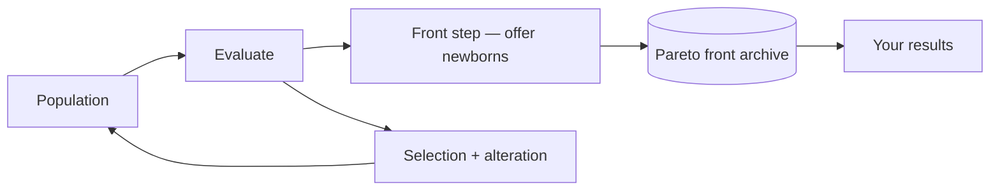

# Objectives

___
Objectives define the direction of optimization for your genetic algorithm. They determine whether the algorithm should minimize or maximize the fitness function, and support both single-objective and multi-objective optimization problems.

The choice of objective is fundamental to the genetic algorithm's behavior, as it directly influences how individuals are ranked, selected, and evolved. Understanding how to properly configure objectives is essential for achieving optimal results in your optimization problems.

!!! note "**The default objective is to maximize a single objective**."

    This means that if you do not specify an objective, the algorithm will assume you want to maximize a single fitness function. If you want to minimize or use multi-objective optimization, you must explicitly configure it - see below.

## Overview

| Objective Type | Ex. Use Cases | Complexity | Performance |
|----------------|----------|------------|-------------|
| [Single Minimize](#minimization) | Error/loss functions, cost optimization | Low | High |
| [Single Maximize](#maximization) | Profit/revenue, performance metrics | Low | High |
| [Multi-Objective](#multi-objective-optimization) | Conflicting objectives, trade-off analysis | High | Medium |

___

## Single-Objective Optimization

Single-objective optimization focuses on optimizing one specific goal. This is by far the most common use case for genetic algorithms. 
When using a single objective, you must return only a single value from your fitness function, which represents the fitness score for that individual.

---

### Minimization

> **Purpose**: Find the minimum value of the fitness function

The `minimizing()` method configures the genetic algorithm to find the minimum value of your fitness function. This is commonly used for error functions, cost optimization, and any scenario where you want to reduce a metric.

=== ":fontawesome-brands-python: Python"

    ```python
    --8<-- "python/objectives.py:minimizing"
    ```

=== ":fontawesome-brands-rust: Rust"

    ```rust
    --8<-- "rust/objectives.rs:minimizing"
    ```

**Common Applications:**

- **Error Functions**: Minimize prediction error in machine learning
- **Cost Optimization**: Minimize production costs, travel distance
- **Constraint Violations**: Minimize penalty for constraint violations
- **Loss Functions**: Minimize training loss in neural networks

---

### Maximization

> **Purpose**: Find the maximum value of the fitness function

This is the default option for the `GeneticEngine`, so you don't really need to explicitly set this, but the functionality is provided for clarity and explicitness. The `maximizing()` method configures the genetic algorithm to find the maximum value of your fitness function. This is commonly used for profit optimization, performance metrics, and any scenario where you want to increase a metric.

=== ":fontawesome-brands-python: Python"

    ```python
    --8<-- "python/objectives.py:maximizing"
    ```

=== ":fontawesome-brands-rust: Rust"

    ```rust
    --8<-- "rust/objectives.rs:maximizing"
    ```

**Common Applications:**

- **Profit Optimization**: Maximize revenue, return on investment
- **Performance Metrics**: Maximize accuracy, precision, recall
- **Quality Scores**: Maximize product quality, user satisfaction
- **Resource Utilization**: Maximize efficiency, throughput

---

## Multi-Objective Optimization

Multi-objective optimization allows you to optimize multiple conflicting objectives simultaneously. Instead of finding a single "best" solution, you find a set of Pareto-optimal solutions that represent different trade-offs between objectives. You'll notice in the examples below that the fitness function returns a list of values, each representing a different objective. The number of objectives should match the number of directions specified.

> **Purpose**: Optimize multiple conflicting objectives simultaneously

With multiple objectives there's rarely a single "best" solution — improving one objective usually means giving ground on another. The key idea is **Pareto dominance**: solution *A* dominates solution *B* if it is at least as good as *B* on **every** objective and strictly better on **at least one**. The solutions that *no* other solution dominates form the **Pareto front** — the set of best available trade-offs. Rather than collapsing everything down to one winner, multi-objective optimization evolves and returns this whole front, leaving the final trade-off choice to you.

---

### Setting Up MO Problems

To configure multi-objective optimization, give the engine one optimization direction per objective, in the same order your fitness function returns them. To bound how many solutions the engine keeps on the Pareto front, set the **front-size range** — `front_range(min, max)` in Python, `front_size(min..max)` in Rust. It defaults to `800..900`.

=== ":fontawesome-brands-python: Python"

    ```python
    --8<-- "python/objectives.py:multi_objective"
    ```

=== ":fontawesome-brands-rust: Rust"

    ```rust
    --8<-- "rust/objectives.rs:multi_objective"
    ```

---

### The Pareto Front

For a multi-objective run, the Pareto front is the answer. It's the set of trade-offs the engine has found that no other solution beats on every objective. Unlike most libraries which use the population itself to represent the front, radiate keeps that set in a `Front` object, separate from the population.

#### How it fits into the engine

The front is an **archive** that sits beside the population. After each generation is evaluated, the engine offers that generation's **newborns** to the front. Nothing in the engine reads the front back: selection, including the NSGA-II and NSGA-III selectors, always works on the population. So the front is a pure output. It accumulates the best trade-offs seen over the *whole* run, including ones the population has since lost. This also allows radiate to keep a front that is of different size than the population itself.



See [Life of an epoch](engine/index.md#life-of-an-epoch) for where the front step sits in the full pipeline.

#### How it's maintained

Each newborn offered to the front goes through the same rules:

1. **Rejected** if it duplicates an existing member, or if any existing member dominates it.
2. **Accepted** otherwise, and every existing member it dominates is removed.
3. If the front has grown past the top of the **front-size range**, it's cut back down to the bottom of the range. Every member is already non-dominated at that point, so the cut uses **crowding distance** alone: the most crowded members go first, which keeps the front as spread out as possible.

The front-size range defaults to `800..900`. A wider gap between the bounds means truncation runs less often, at the cost of a larger front between cuts.

#### Reading the front

Every generation from a multi-objective run carries the front, so you can read it from the final result or from any generation you observe along the way. Each member is a scored individual: it has one score per objective and a genotype that your codec decodes back into your problem's representation.

=== ":fontawesome-brands-python: Python"

    ```python
    --8<-- "python/objectives.py:front_reading"
    ```

=== ":fontawesome-brands-rust: Rust"

    ```rust
    --8<-- "rust/objectives.rs:front_reading"
    ```

#### Measuring the front

The front comes with a few tools for judging the quality of the trade-offs it holds:

| Method | What it tells you |
|---|---|
| Hypervolume | The volume of objective space the front dominates, measured from a reference point that is worse than every member on every objective. Higher is better. It's the standard single number for comparing fronts, as long as you use the same reference point. |
| Entropy | How evenly the members are spread along the front. |
| Crowding distance | How isolated each member is from its neighbors, one value per member. Boundary members get the largest values. |
| Remove outliers | Drops the most isolated fraction of members, for example the top 2%. |

=== ":fontawesome-brands-python: Python"

    ```python
    --8<-- "python/objectives.py:front_analysis"
    ```

=== ":fontawesome-brands-rust: Rust"

    ```rust
    --8<-- "rust/objectives.rs:front_analysis"
    ```

#### Front metrics

The front step records its activity in the engine's [metrics](engine/metrics.md) every generation:

| Metric | Meaning |
|---|---|
| `front.size` | Members currently on the front |
| `front.additions` | Newborns accepted this generation |
| `front.removals` | Members removed because a newborn dominated them |
| `front.comparisons` | Dominance comparisons performed |
| `front.filters` | Times the front was truncated back to its range |
| `front.entropy` | The front's entropy. It's expensive to compute, so it's only updated every 10 generations. |

!!! note "Snapshots copy the front"

    Each `Generation` snapshot of a multi-objective run includes its own copy of the front, so with a large front, building a snapshot every generation adds up. The [runtime](engine/runtime.md) page covers which ways of running the engine build a snapshot every generation and which build one only at the end.

---

### MO Selectors

Because of the complexity of multi-objective problems, specialized selectors are available which are optimized for handling Pareto dominance and diversity:

- `NSGA2Selector`: Implements the NSGA-II algorithm for non-dominated sorting and crowding distance
- `NSGA3Selector`: Implements the NSGA-III algorithm for many-objective optimization
- `TournamentNSGA2Selector`: Uses tournament selection with Pareto dominance

Although, any selector can be used, these are optimized for multi-objective problems. The other selectors will work by computing a 'weight' based off of the pareto dominance and crowding distance, but they are not backed by any specific multi-objective algorithm.

=== ":fontawesome-brands-python: Python"

    ```python
    --8<-- "python/objectives.py:multi_objective_selectors"
    ```

=== ":fontawesome-brands-rust: Rust"

    ```rust
    --8<-- "rust/objectives.rs:multi_objective_selectors"
    ```

---

### Recommended Configuration

For real-valued multi-objective problems, a good starting point is the classic NSGA-II / NSGA-III setup:

| Setting | Recommendation | Why |
|---|---|---|
| Offspring selector | Tournament NSGA-II | Picks parents by Pareto rank, then crowding distance. A plain tournament ranks by the first objective only, which pulls the population toward one end of the front. |
| Survivor selector | NSGA-II for 2 objectives, NSGA-III for 3 or more | NSGA-III's reference-point niching spreads solutions better as the number of objectives grows. With NSGA-III, a population roughly the size of the number of reference points works well (12 partitions over 3 objectives gives 91 points). |
| Offspring fraction | Around `0.5` | Survivors are selected from the current population before new offspring are evaluated, and offspring always enter the next generation. A lower fraction keeps more of the already-evaluated front each generation, which improves both convergence and spread. |
| Crossover | Simulated Binary Crossover, distribution index ≈ 20 | The standard real-valued crossover for NSGA-II/III. Higher indices keep children closer to their parents. |
| Mutation | Polynomial mutation, distribution index ≈ 20 | Makes small, bounded perturbations around the current value. Uniform mutation replaces genes with random values, which repeatedly undoes convergence. |

The selector example above and the [DTLZ1 example](examples.md#dtlz1) use this configuration.

---

## Best Practices

### Choosing Objectives

1. **Single-objective**: Use when you have a clear, single goal
2. **Multi-objective**: Use when objectives conflict or you need trade-off analysis
3. **Objective count**: Keep multi-objective channels to a manageable number

### Performance Considerations

1. **Single-objective**: Generally faster and more focused
2. **Multi-objective**: More computationally intensive
3. **Front size**: Larger fronts provide better coverage but increase memory usage and computation time
4. **Objective count**: More objectives increase complexity exponentially

---

## Troubleshooting

### Common Issues

1. **Problem**: Algorithm converges to poor solutions
    - Solution: Check objective direction (minimize vs maximize)

2. **Problem**: Multi-objective front is too small
    - Solution: Increase front size range or adjust selection pressure
